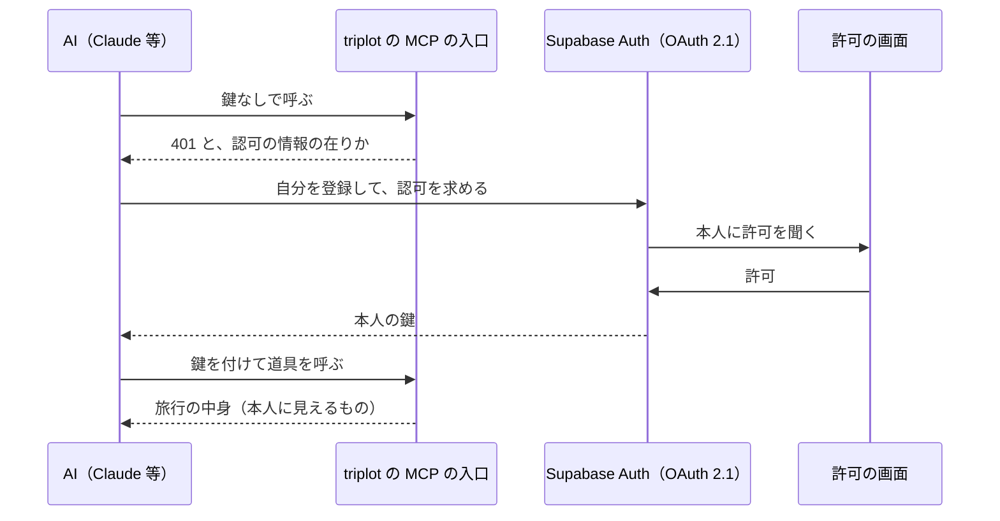

# AI から旅行を読み書きする（MCP サーバー）

Claude・ChatGPT・Gemini・Meta Muse などの AI に旅行を見てもらい、計画の途中で何度でも
アドバイスをもらえるようにする。計画は流動的なので、その時点の写し（エクスポート）では
なく、AI がいつも最新の中身を読めるようにする。相談の流れで決まったもの（行きたい場所・
予定・TODO・費用）は、AI がそのまま足せる。

## 形

triplot を **MCP サーバー**として公開し、各 AI の「カスタムコネクタ」からつなぐ。

- **AI は旅行のメンバーにならない。ログインした本人の代理として動く。** AI は本人が
  許可した鍵（本人の JWT）で読み書きするので、見えるものもできることも本人と同じで、
  RLS がそのまま効く。メンバーが増えないので、TODO の「全員」や割り勘の対象に AI が
  数えられることもない。
- **AI 経由で足したものは、本人が足したもの。** 作成者は本人になり、「AI が足した」
  印は付けない（本人が AI に頼んで足させた、という事実の通り）。
- 「見るだけのメンバー」（保護者など）とは別の話。そちらはメンバーの権限の柱に
  閲覧者を足す変更で、AI のためには要らない。

## 部品

| 部品 | 場所 | 役割 |
|---|---|---|
| MCP の入口 | `apps/web/app/api/mcp/[[...path]]/route.ts` | 鍵を確かめ、本人の権限の Supabase クライアントで道具を動かす。鍵が無ければ 401 と認可の情報の在りかを返す（`@supabase/server`）。**AI に発行した鍵（`client_id` 入り）だけを通す**（MCP の仕様は、自分宛ての鍵しか受け付けないことを求めている。アプリの普段のログインの鍵は通さない） |
| 道具 | 同上 | 下の表 |
| 中身の文章 | `packages/shared/src/tripForAi.ts` | 旅行の中身を AI が読む Markdown にする（下記） |
| 書き込み | `packages/shared/src/data/aiWrites.ts` | AI が送る「人が読む形」（メンバーの名前・場所の名前・時差付きの時刻）を triplot の持ち方に直して、アプリと同じ作成の処理を呼ぶ |
| 時刻の受け渡し | `packages/shared/src/aiTime.ts` | 下の「時刻」 |
| 許可の画面 | `apps/web/app/oauth/consent/` | 「〇〇 があなたの triplot につなごうとしています」。許可・拒否を Supabase に返す |
| 認可 | Supabase Auth の OAuth 2.1 サーバー | AI の登録（動的クライアント登録）・認可コード・鍵の発行 |
| 中継（staging だけ） | `supabase/functions/mcp` | 下の「環境」 |

通信は Streamable HTTP で、要求ごとにサーバーを作り直す（状態を持たないので Vercel の
関数のまま動く）。Gemini はこの方式しか受け付けない。

### 道具

| 道具 | すること |
|---|---|
| `list_trips` | 旅行の一覧 |
| `get_trip` | 旅行1つの中身（予定・場所・費用・TODO・ノート） |
| `search_places` | 旅行の近くで場所を Google で探す。足す時に使う Google の場所の id を返す |
| `add_place` | 場所を足す（既定は候補。決定も選べる） |
| `add_todo` | TODO を足す（旅行前／旅行中） |
| `add_event` | 予定を足す（時刻のある予定・終日の予定） |
| `add_transit` | 移動を足す（両端の時刻とタイムゾーン） |
| `add_expense` | 費用を足す（支払った人・割り勘・換算レート） |
| `update_event` / `update_transit` / `update_place` / `update_todo` / `update_expense` | 変える。送られてこなかった項目は今の値のまま |
| `delete_item` | 予定（移動を含む）・場所・TODO・費用を消す |

### どれを指すか（変える・消す）

`get_trip` の各項目に id を添え、変える・消す道具はその id で受ける。**id は AI と
triplot の間だけで使い、利用者には見せない**（`get_trip` の先頭でそう指示している）。
利用者は「12日の朝食を8時にずらして」と言うだけで、AI が中身を読んで該当する id を選ぶ。
名前で指させると、毎日ある「朝食」のような同名の項目を取り違える。

当てはまるものが複数ある時の手当て:

- 道具の説明で「複数に当てはまる時は、変える前に利用者に聞くこと」と指示する（AI は
  道具の説明を読んで動く）。必ず聞き返すかは AI 次第で、こちらからは強制できない。
- 返事に、どれを変えたか・前と後の値を入れる（「8/12 07:00 朝食 → 08:00」）。AI が
  それを利用者に伝えるので、違うものを指していたらその場で気付ける。
- 消した時は消したものの中身を返す。アプリの「元に戻す」はトーストからしか押せない
  ので、AI 経由で消したものは、AI に頼んで同じ内容で足し直すのが戻す手段になる。

失敗は、AI がそのまま読んで直せる文で返す（何が足りないか・何を送り直すか）。
例: 知らないメンバーの名前には、選べる名前を添えて断る。

### 時刻

triplot は予定・費用の時刻を**現地の壁時計**で持ち、タイムゾーンは旅程（移動）から毎回
決める（[timezone.md](./timezone.md)）。AI はこの決まりを知らないので、壁時計だけを
やり取りすると「日本時間のつもりで書いた」ずれが起きる。

そこで AI とは **時差付きの時刻**（ISO 8601、例 `2027-08-11T12:00-10:00`）で
やり取りする。現地の時刻と世界で1つの瞬間の両方が入っていて、AI も扱い慣れている。
UTC にはしない（計画は現地の時計で考えるので、毎回の換算でかえって間違える）。

- **読む時**: 時刻に時差とタイムゾーン名を添える（画面と同じ規則で旅程から決めたもの）。
- **書く時**: 時差の無い時刻は受け付けない。その日その時刻に旅行（予定なら参加者、費用
  なら支払った人）がいるタイムゾーンを旅程から求め、時差を突き合わせる。
  - 合えば、triplot の持ち方（現地の壁時計。移動の日はどちら側か）に直して保存する
  - 食い違えば保存せず、正しい時差を添えて断る（「8/12 は Pacific/Honolulu（-10:00）に
    います。現地の 7:00 のつもりなら `…T07:00-10:00` で送り直して」）。AI はこれを読んで
    自分で直せる
  - 旅程に移動が無い旅行は、どこにいるかの根拠が無いので突き合わせない
- **移動**は両端のタイムゾーン名を必須にし、時差がそのタイムゾーンと合うかを見る。

### 費用の換算レート

指定があればそれ、無ければ旅行の中の同じ通貨の費用の平均（アプリのフォームの初期値と
同じ）、それも無ければその日の為替（先の日付は今日の為替）。どれも無ければ断って、
レートを聞くよう AI に返す。

### 中身の文章（`tripForAi`）

読むのは AI なので、画面の見た目ではなく抜けなく・取り違えなく書く。

- 見出しは英語。AI はどの言語でも読め、答える言語は会話で決まる。中身は利用者が書いたまま。
- 時刻は現地の時刻に時差とタイムゾーン名を添える（上の「時刻」）。並びは実際の時刻順
  （移動の日は、出発地の夜が到着地の昼より先に来ることがある）。
- 自分だけのものには印を付ける。AI が「他のメンバーにも見えている」前提で話さないように。

## 環境

コードに環境の分岐は無く、設定だけで分かれる（他の機能と同じ）。

| | AI がつなぐ URL | 認可 |
|---|---|---|
| 本番 | `https://triplot.app/api/mcp` | 本番の Supabase |
| staging | `https://xuytnpkvmiduffigimol.supabase.co/functions/v1/mcp` | staging の Supabase |

staging の web は Vercel の保護の内側にあり、外の AI からは届かない。そこで staging だけ
Supabase の Edge Function（`mcp`）が保護を越える鍵を預かって web へ取り次ぐ
（[share-extension.md](./share-extension.md) の中継と同じ考え方）。AI から見た入口は
この関数になるので、認可の情報に載せる入口の URL を web の環境変数で差し替える。

### 設定

**Supabase（本番・staging それぞれ）**: Authentication → OAuth Server で

- OAuth Server を有効にする
- Allow Dynamic OAuth Apps を有効にする（AI が自分で登録するため）
- Authorization Path を `/oauth/consent` にする（Site URL と組み合わせて許可の画面になる）

鍵の署名は ES256（非対称）であること。`@supabase/server` が HS256 の鍵を受け付けないため。

**Vercel（staging だけ）**: `MCP_RESOURCE_URL` = staging の中継の URL（上の表）。
本番は置かない（web 自身の URL になる）。

**Edge Function の設定値（staging だけ）**: `MCP_WEB_URL` = staging の Vercel の URL、
`VERCEL_BYPASS`（shared-place と共通）。関数は `npm run functions:deploy -- mcp --staging`
で出す。本番には出さない。

## 気をつけること

- **AI の登録は誰でもできる。** 名前は名乗った通りにしか出せないので、許可の画面に
  戻り先のドメインも出し、利用者が見分けられるようにしている。
- **鍵は本人と同じ権限。** 道具は足すだけでも、AI が Supabase を直に叩けば本人が
  できることは全部できる（本人以上のことはできない）。AI からの操作を絞る必要が出たら、
  RLS で鍵の `client_id`（どの AI から来たか）を見る。
- **OAuth 2.1 サーバーはベータ。** 挙動や設定が変わることがある。
- 使える範囲は AI の側で決まる（ChatGPT の個人プランは読むだけの可能性、Muse は
  米国・カナダだけ、等）。
