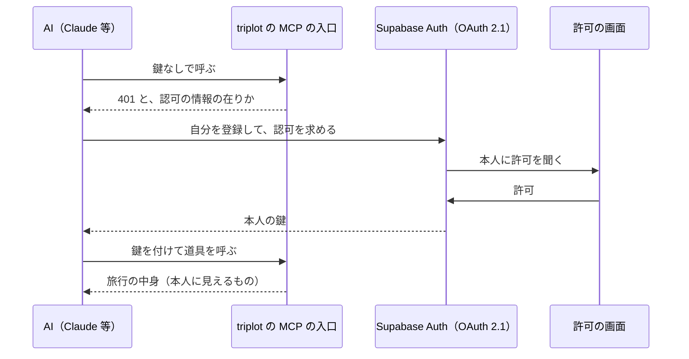

# AI から旅行を読む（MCP サーバー）

Claude・ChatGPT・Gemini・Meta Muse などの AI に旅行を見てもらい、計画の途中で何度でも
アドバイスをもらえるようにする。計画は流動的なので、その時点の写し（エクスポート）では
なく、AI がいつも最新の中身を読めるようにする。

## 形

triplot を **MCP サーバー**として公開し、各 AI の「カスタムコネクタ」からつなぐ。

- **AI は旅行のメンバーにならない。ログインした本人の代理として動く。** AI は本人が
  許可した鍵（本人の JWT）で読むので、見えるものは本人と同じで、RLS がそのまま効く。
  メンバーが増えないので、TODO の「全員」や割り勘の対象に AI が数えられることもない。
- 「見るだけのメンバー」（保護者など）とは別の話。そちらはメンバーの権限の柱に
  閲覧者を足す変更で、AI のためには要らない。

## 部品

| 部品 | 場所 | 役割 |
|---|---|---|
| MCP の入口 | `apps/web/app/api/mcp/[[...path]]/route.ts` | 鍵を確かめ、本人の権限の Supabase クライアントで道具を動かす。鍵が無ければ 401 と認可の情報の在りかを返す（`@supabase/server`）。**AI に発行した鍵（`client_id` 入り）だけを通す**（MCP の仕様は、自分宛ての鍵しか受け付けないことを求めている。アプリの普段のログインの鍵は通さない） |
| 道具 | 同上 | `list_trips`（旅行の一覧）・`get_trip`（旅行1つの中身） |
| 中身の文章 | `packages/shared/src/tripForAi.ts` | 旅行の中身を AI が読む Markdown にする（下記） |
| 許可の画面 | `apps/web/app/oauth/consent/` | 「〇〇 があなたの triplot につなごうとしています」。許可・拒否を Supabase に返す |
| 認可 | Supabase Auth の OAuth 2.1 サーバー | AI の登録（動的クライアント登録）・認可コード・鍵の発行 |
| 中継（staging だけ） | `supabase/functions/mcp` | 下の「環境」 |

通信は Streamable HTTP で、要求ごとにサーバーを作り直す（状態を持たないので Vercel の
関数のまま動く）。Gemini はこの方式しか受け付けない。

### 中身の文章（`tripForAi`）

読むのは AI なので、画面の見た目ではなく抜けなく・取り違えなく書く。

- 見出しは英語。AI はどの言語でも読め、答える言語は会話で決まる。中身は利用者が書いたまま。
- 時刻は保存してある壁時計のまま（予定は現地の時刻で持っている。[timezone.md](./timezone.md)）。
  TZ を持つのは移動だけなので、移動にだけ両端の TZ を添える。
- 自分だけのものには印を付ける。AI が「他のメンバーにも見えている」前提で話さないように。

## 環境

コードに環境の分岐は無く、設定だけで分かれる（他の機能と同じ）。

| | AI がつなぐ URL | 認可 |
|---|---|---|
| 本番 | `https://triplot.app/api/mcp` | 本番の Supabase |
| staging | `https://xuytnpkvmiduffigimol.supabase.co/functions/v1/mcp` | staging の Supabase |

staging の web は Vercel の保護の内側にあり、外の AI からは届かない。そこで staging だけ
Supabase の Edge Function（`mcp`）が保護を越える鍵を預かって web へ取り次ぐ
（[share-extension.md](./share-extension.md) の中継と同じ考え方）。AI から見た入口は
この関数になるので、認可の情報に載せる入口の URL を web の環境変数で差し替える。

### 設定

**Supabase（本番・staging それぞれ）**: Authentication → OAuth Server で

- OAuth Server を有効にする
- Allow Dynamic OAuth Apps を有効にする（AI が自分で登録するため）
- Authorization Path を `/oauth/consent` にする（Site URL と組み合わせて許可の画面になる）

鍵の署名は ES256（非対称）であること。`@supabase/server` が HS256 の鍵を受け付けないため。

**Vercel（staging だけ）**: `MCP_RESOURCE_URL` = staging の中継の URL（上の表）。
本番は置かない（web 自身の URL になる）。

**Edge Function の設定値（staging だけ）**: `MCP_WEB_URL` = staging の Vercel の URL、
`VERCEL_BYPASS`（shared-place と共通）。関数は `npm run functions:deploy -- mcp --staging`
で出す。本番には出さない。

## 気をつけること

- **AI の登録は誰でもできる。** 名前は名乗った通りにしか出せないので、許可の画面に
  戻り先のドメインも出し、利用者が見分けられるようにしている。
- **鍵は本人と同じ権限。** 道具が読むだけでも、AI が Supabase を直に叩けば本人が
  できることは全部できる。本人以上のことはできないが、「AI からは読むだけ」を本当に
  守るなら、RLS で鍵の `client_id`（どの AI から来たか）を見る。
- **OAuth 2.1 サーバーはベータ。** 挙動や設定が変わることがある。
- 使える範囲は AI の側で決まる（ChatGPT の個人プランは読むだけの可能性、Muse は
  米国・カナダだけ、等）。
