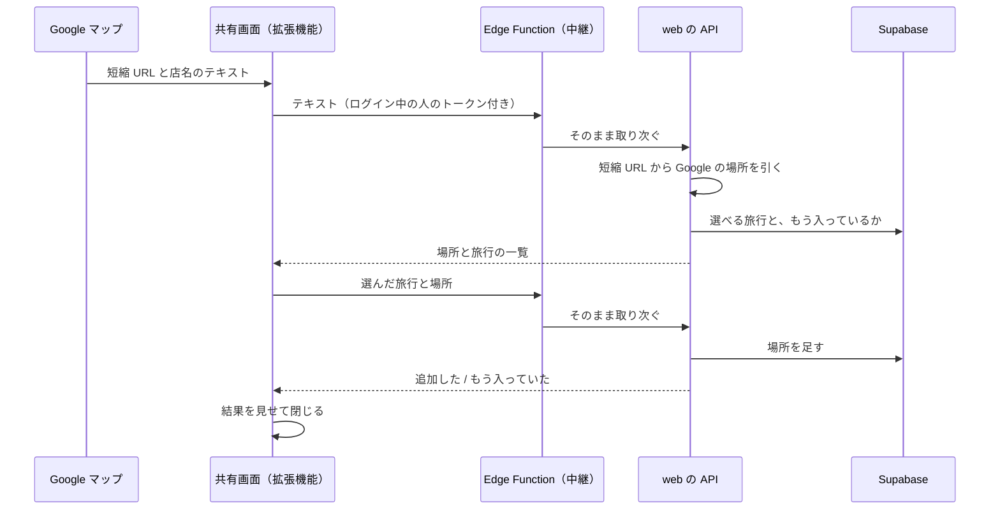

# Google マップの「共有」から場所を足す（iOS）

Google マップの共有ボタンから triplot を選ぶと、**triplot を開かずに**その場で旅行を
選び、場所を足して閉じる。LINE の転送（LINE を開かずにトークルームを選ぶ）と同じ形。

## 1. 流れ

## 2. 旅行を選んだら終わり

共有画面は追加フォームを出さず、旅行を選んだ時点で保存する。

- 公開範囲は共有、メモは無し。
- アイコンは Google の種類（restaurant など）から推測し、**その旅行のピンに無ければ
  ピン**にする（`iconForSharedPlace`）。旅行のピンは旅行ごとに選んだ凡例なので、
  推測のために増やさない。
- その旅行に同じ場所がもうあれば足さず、「もう入っています」と返す。一覧でも
  「追加済み」と見せる。
- アプリを開く導線は置かない。直したい時はアプリから場所を開く。

## 3. 判断は web の API に置き、共有画面は描くだけ

共有画面は SwiftUI で書く（`apps/mobile/targets/share`）。拡張機能は使えるメモリが
小さく、一覧とボタンだけの画面に React Native の実行環境ごと載せる理由が無い。

その代わり、Swift には判断を持たせない。場所を引く（`resolveGoogleMapsShare`）・
旅行を並べる・重複を確かめる・アイコンを決める、は web の `/api/shared-place` と
`@triplot/shared/data/sharedPlace` が持つ。Swift に書き直すと二重実装になり、vitest
のテストも届かなくなる。

## 4. Edge Function で取り次ぐ

共有画面は web を直に呼ばず、Supabase の Edge Function（`supabase/functions/shared-place`）
を呼ぶ。中継は宛先と鍵を預かるだけで、中身は解釈しない（`flight-lookup` と同じ）。

- **staging の web には Vercel の保護がかかっている。** 外から呼ぶには保護を越える鍵が
  要り、アプリに持たせると配布した ipa から抜かれる。中継に置けば鍵はサーバーの外に出ない。
- **宛先がビルドの向き先で自然に分かれる。** 共有画面はアプリ本体と同じ Supabase を
  呼ぶので、preview は staging、TestFlight と App Store は本番に届く。

中継の設定（Supabase の secrets）:

| 名前 | 本番 | staging |
|---|---|---|
| `SHARED_PLACE_WEB_URL` | `https://triplot.app` | staging の Vercel の URL |
| `VERCEL_BYPASS` | 無し | Vercel の Protection Bypass for Automation の値（心拍の Worker と同じもの） |

## 5. ログイン状態をアプリ本体と分け合う

共有画面はログイン中の人として旅行を読み書きするので、トークンが要る。アプリ本体は
セッションを**両方が入れるキーチェーンのグループ**に置き
（`apps/mobile/src/lib/authSessionStore.ts`）、共有画面はそこから読む。

- 置き方は expo-secure-store の形に合わせる（サービス名 `triplot.session:no-auth`、
  アカウントは supabase-js のキー、グループは「チーム ID.本体の bundle id」）。
  片方を変えたらもう片方も変える。
- **トークンの期限が切れていたら、共有画面が取り直してキーチェーンに書き戻す。**
  supabase-js はセッションを使うたびに保存先から読み直すので、アプリ本体は取り直した
  トークンをそのまま使う。古いトークンで取り直そうとして弾かれることが無い。
- 以前の版はセッションを AsyncStorage に置いていた。初めて読んだ時にキーチェーンへ
  写すので、版を上げてもログアウトされない。

宛先（Supabase の URL と anon key）とキーチェーンのグループは、アプリ本体の
Info.plist から読む（`app.config.ts` の `TriplotSupabaseURL` など）。拡張機能は
アプリ本体の中に入っているので、向き先はアプリ本体のものを見ればよい。
